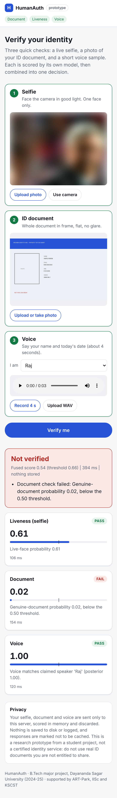
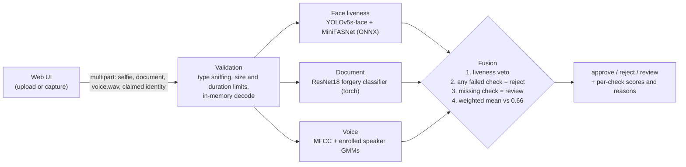

# HumanAuth: Multi-Factor AI Identity Verification

[](https://github.com/basavarajnaduvinamani/HumanAuth/actions/workflows/ci.yml)
[](https://artpark.in/)
[](https://www.python.org/)
[](https://onnxruntime.ai/)
[](LICENSE)

**What it is:** an onboarding-style identity check that scores a live selfie, an ID document photo and a short voice sample with three separate models, then fuses them into one decision with a liveness veto and plain-language reasons.

**Who it is for:** teams prototyping e-KYC or account-recovery flows (banking, government services) who want to see how multi-factor biometric checks behave together, and reviewers who want to inspect a student research prototype end to end.

**Status:** research prototype. It is a 4-person B.Tech major project at Dayananda Sagar University (2024-25), funded by a KSCST / IISc ART-Park student grant. It is not a certified identity service, and the thresholds are not calibrated on a held-out set.

## Demo


<p align="center"></p>

These are real gateway outputs from the bundled weights, captured with Playwright at 1280 px and 390 px. The selfie is a face cropped from the YOLOv5 sample image bundled in this repo, blurred in the screenshot. The document is a synthetic "SPECIMEN" card, which the classifier rejects. The voice clip is the bundled `modules/voice_authentication/test.wav`.

## Run it

```bash
pip install -r requirements.txt          # CPU is fine; no GPU needed
python -m gateway --port 5000            # open http://localhost:5000
```

Or use the API directly:

```bash
curl -F selfie=@me.jpg -F document=@id.jpg -F voice=@me.wav -F claimed_identity=Raj \
     http://localhost:5000/api/verify
curl http://localhost:5000/api/health    # which modules are loaded, and why not
```

Tests (offline, with stubbed models and tiny synthetic fixtures):

```bash
pip install -r requirements-dev.txt && python -m pytest -q
```

## Results

### Reported in the signed project report

These figures come from the team's signed Phase-II project report (2024-25). They were not re-run here. The report does not identify the evaluation split, so treat them as reported figures, not held-out benchmarks.

| Task | Reported value | Note |
| --- | --- | --- |
| Integrated (fused) authentication accuracy | **96.5%** | Signed report, results table (p. 31) |
| Face anti-spoofing accuracy | **96.0%** | Signed report, Table 5.5.4 (p. 30). Section 5.6.1 of the same report gives 96.2%. |
| Document forgery classifier, **training** accuracy | 98.5% | Training accuracy only. The report gives 100% validation. This is **not** a deepfake or fraud-detection accuracy. |

Not used here: the face metrics table in `modules/face_anti_spoofing/README.md` (accuracy 0.9292 / 0.9328). Those numbers belong to the upstream Lanit-Tercom summer-school 2022 MiniFASNet project that the face module builds on, not to this team. Earlier versions of this README claimed "98.5% overall fraud detection", "< 1.2 s", "FAR < 0.1%" and "FRR < 1.2%". None of those has a run behind it in this repo, so they were removed.

### Measured in this repo

**Gateway latency on CPU** (`python bench/latency.py`, raw data in [`bench/results/latency_cpu.json`](bench/results/latency_cpu.json)). Hardware: Intel Xeon @ 2.80 GHz, 4 logical cores, 15.7 GB RAM, no GPU. Software: Python 3.13, torch 2.15, onnxruntime 1.31. Inputs are the bundled samples. Each stage is timed from bytes in server memory to that stage's output. Camera and microphone capture, network upload and browser rendering are not included.

| Stage (warm, n = 50) | p50 ms | p95 ms |
| --- | ---: | ---: |
| Face detection (YOLOv5s-face, ONNX) | 71.6 | 109.9 |
| Face anti-spoofing (MiniFASNet, ONNX) | 9.8 | 11.6 |
| Document classifier (ResNet18, torch) | 40.2 | 49.0 |
| Voice features (MFCC + deltas, 4 s clip) | 63.2 | 90.0 |
| Voice GMM scoring (2 speakers) | 6.1 | 7.1 |
| Whole `POST /api/verify` (in-process Flask test client) | 524.6 | 1506.0 |

Cold start (fresh process, n = 3): the p50 from process start to first response is 7.2 s. Of that, about 4.9 s is loading torch and the document model. One of the three cold runs took 161 s, almost certainly because the disk cache was cold, and it is kept in the JSON. The whole-request number also includes multipart encoding and parsing of the roughly 0.75 MB upload, which is why it is larger than the sum of the stages.

**Document label-map check** (`python bench/doc_class_map.py`, data in [`bench/results/doc_class_map.json`](bench/results/doc_class_map.json)). The repo's original inference scripts read output index 0 as "Real". On the bundled annotated regions, index 0 agrees with the dataset's **fake** label 99.8% / 100% / 99.2% of the time (train / valid / test). So those scripts had the label backwards, and the gateway now uses `fake, real`. The same check found that all 31 valid and all 40 test images share a source page with a training image (Roboflow augmentations). The bundled splits are therefore not source-disjoint, and they say nothing about generalisation.

## Architecture



* `gateway/` is the single API. It has the Flask app, the validation code, the fusion rules and one adapter per module. Each adapter loads its model the first time it is used. If the weights or a package are missing, the adapter returns `status: "unavailable"` with the reason and never returns a made-up score. The gateway never approves without all three checks; it sends the case to manual review instead.
* Privacy: uploads are decoded in memory and dropped as soon as they are scored. Nothing is written to disk or logged, and responses carry `Cache-Control: no-store`.
* `modules/` holds the original research code. The gateway wraps it without changing it.

| Module | What runs in the gateway | Known limits |
| --- | --- | --- |
| `face_anti_spoofing` | `AntiSpoofing_bin_1.5_128.onnx` and `yolov5s-face.onnx` through the module's own classes. Class 0 is live; the threshold of 0.5 is the `video_predict.py` default. | Single still image, no challenge-response. The model lineage is upstream MiniFASNet. |
| `document_forgery_detection` | `forgery_classifier.pth` (ResNet18) on the whole image, with the preprocessing from `predict_single_image.py`. | It was trained on annotated region crops, so a whole-document score is outside its training setup. The splits are not source-disjoint (see above). |
| `voice_authentication` | The enrolled `gmm_models/*.gmm`, loaded with a restricted unpickler and scored in numpy (this matches sklearn's `GaussianMixture.score`). Features replicate `main_functions.extract_features`. | Closed set with no impostor model, so an unknown voice is still matched to the nearest enrolled speaker. This is speaker matching, **not** synthetic-speech detection. The CNN-LSTM deepfake detector described in the report is not in this repo. |
| face recognition (FaceNet) | Not wired. `keras_facenet` downloads its weights at runtime, and the bundled `facenet_model/model.h5` targets a TF1/Keras 2.2 stack. | |
| `score_fusion/app.py` | Legacy manual score-entry page, kept for reference and replaced by `gateway/`. | |

## Repository layout

```text
gateway/            Flask API + web UI (python -m gateway)
  checks/           face.py, document.py, voice.py adapters over modules/
  fusion.py         decision rules with liveness veto
  validation.py     upload checks
bench/              latency.py, doc_class_map.py, results/
tests/              offline pytest suite (stubs + real-weight smoke tests that skip without deps)
modules/            original research code and weights (face, document, voice, legacy score fusion)
docs/img/           screenshots
```

## What still needs owner runs

* `python bench/latency.py` on your own laptop, to add a second hardware row.
* A held-out, source-disjoint evaluation of each module and of the fusion rule (attack acceptance and genuine rejection rates), before any accuracy is quoted beyond the reported figures above.

## Team and credit

HumanAuth was built as a B.Tech CSE major project (Phase II, 2024-25) at the School of Engineering, Dayananda Sagar University, by **Basavaraj A Naduvinamani** (lead engineer), **Pushpa Priya N**, **S Thriveni** and **Sahana N**, guided by Prof. Navya Damodar.

## Funding

The project received funding from the **AI & Robotics Technology Park (ART-Park), Indian Institute of Science (IISc), Bengaluru**, with technical support from the **Karnataka State Council for Science and Technology (KSCST)** under the Student Project Programme, 48th Series (project reference 48S_BE_5942).

## License

[MIT](LICENSE). The face anti-spoofing module is based on the Lanit-Tercom summer-school 2022 project, which uses the Silent-Face-Anti-Spoofing (MiniFASNet) architecture. The bundled document dataset is a Roboflow export under CC BY 4.0.
