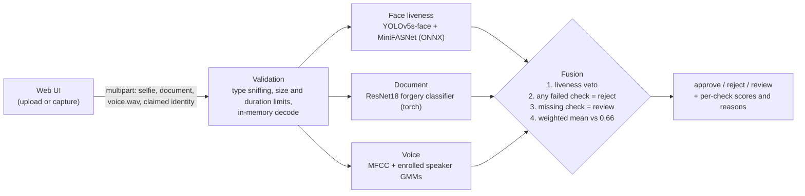

# HumanAuth: Multi-Factor AI Identity Verification

[](https://github.com/basavarajnaduvinamani/HumanAuth/actions/workflows/ci.yml)
[](https://artpark.in/)
[](https://www.python.org/)
[](https://onnxruntime.ai/)
[](LICENSE)

**What it is:** an onboarding-style identity check that scores a live selfie, an ID document photo and a short voice sample with three separate models, then fuses them into one decision with a liveness veto and plain-language reasons.

**Who it is for:** teams prototyping e-KYC or account-recovery flows (banking, government services) who want to see how multi-factor biometric checks behave together, and reviewers who want to inspect a student research prototype end to end.

**Status:** research prototype. It is a 4-person B.Tech major project at Dayananda Sagar University (2024-25), funded by a KSCST / IISc ART-Park student grant. It is not a certified identity service, and the thresholds are not calibrated on a held-out set.

## Demo


<p align="center"></p>

These are real gateway outputs from the bundled weights, captured with Playwright at 1280 px and 390 px. The selfie is a face cropped from the YOLOv5 sample image bundled in this repo, blurred in the screenshot. The document is a synthetic "SPECIMEN" card, which the classifier rejects. The voice clip is the bundled `modules/voice_authentication/test.wav`.

## Run it

```bash
pip install -r requirements.txt          # CPU is fine; no GPU needed
python -m gateway --port 5000            # open http://localhost:5000
```

Or use the API directly:

```bash
curl -F selfie=@me.jpg -F document=@id.jpg -F voice=@me.wav -F claimed_identity=Raj \
     http://localhost:5000/api/verify
curl http://localhost:5000/api/health    # which modules are loaded, and why not
```

Tests (offline, with stubbed models and tiny synthetic fixtures):

```bash
pip install -r requirements-dev.txt && python -m pytest -q
```

## Results

### Reported in the signed project report

These are reported figures, not rerun or held-out benchmarks. Their signed-report
locations and source digest are recorded in
[`bench/results/reported_results_reference.json`](bench/results/reported_results_reference.json).

| Task | Reported value | Scope |
| --- | ---: | --- |
| Integrated authentication | 96.5% | not identified |
| Facial anti-spoofing | 96.0% | not identified |
| Document classifier | 98.5% | training |

The upstream face module retains its own results table for attribution; those are
not the team's runs. Earlier unsupported overall-fraud, latency and acceptance-rate
claims are not used as project evidence here.

### Measured in this repo

The previous CPU measurement is preserved and the local hardware measurement is
added below. These are core-gateway latency measurements; the optional recovered
voice detector is disabled. Every cell comes from the linked raw result file.

| Hardware | Warm requests | p50 ms | p95 ms | Source |
| --- | ---: | ---: | ---: | --- |
| Intel(R) Xeon(R) Processor @ 2.80GHz | 50 | 524.62 | 1506.02 | `bench/results/latency_cpu.json` |
| 12th Gen Intel(R) Core(TM) i5-12450H | 50 | 1052.28 | 1215.62 | `bench/results/latency_cpu_12th_gen_intel_r_core_tm_i5_12450h_20261030T161355969061Z.json` |

Local hardware and software details, all stage timings and cold runs are in
[`bench/results/latency_cpu_12th_gen_intel_r_core_tm_i5_12450h_20261030T161355969061Z.json`](bench/results/latency_cpu_12th_gen_intel_r_core_tm_i5_12450h_20261030T161355969061Z.json) and its
[generated table](bench/results/latency_cpu_12th_gen_intel_r_core_tm_i5_12450h_20261030T161355969061Z.md).
The timing boundary includes in-process multipart encoding/parsing, but excludes
capture, network transfer and browser rendering. Run `python bench/latency.py` to
write a separately named hardware/run result without replacing earlier default runs.

The corrected document class order and the overlapping source pages are documented
in [`bench/results/doc_class_map.json`](bench/results/doc_class_map.json).
The fresh local eligibility scan in
[`bench/results/document_split_eligibility.json`](bench/results/document_split_eligibility.json)
found no eligible labeled documents from new training-source pages. Held-out
evaluation was skipped, and no new accuracy was added.

### Recovered optional local detector

An existing local Deep4SNet checkpoint loads and now has an opt-in gateway adapter.
It is a CNN over audio-amplitude histograms, not the report's CNN-LSTM.
Weights stay outside Git. When enabled, its result appears in health and the UI;
failure rejects, and unavailability prevents approval. The core gateway remains
the default. See [local recovery and setup](docs/local_recovery.md),
[source/load evidence](bench/results/local_asset_audit.json),
[inference smoke result](bench/results/voice_deepfake_smoke.json), and
[live loopback verification](bench/results/verification_local.json).
These smoke results are not accuracy benchmarks. The existing FaceNet checkpoint
failed its load probe and remains unwired. The local steganography helper is
preserved for research reference and is not part of verification.

## Architecture



* `gateway/` is the single API. It has the Flask app, the validation code, the fusion rules and one adapter per module. Each adapter loads its model the first time it is used. If the weights or a package are missing, the adapter returns `status: "unavailable"` with the reason and never returns a made-up score. The gateway never approves without every enabled check; it sends incomplete evidence to manual review.
* Privacy: uploads are decoded in memory and dropped as soon as they are scored. Nothing is written to disk or logged, and responses carry `Cache-Control: no-store`.
* `modules/` holds the original research code. The gateway wraps it without changing it.

| Module | What runs in the gateway | Known limits |
| --- | --- | --- |
| `face_anti_spoofing` | `AntiSpoofing_bin_1.5_128.onnx` and `yolov5s-face.onnx` through the module's own classes. Class 0 is live; the threshold of 0.5 is the `video_predict.py` default. | Single still image, no challenge-response. The model lineage is upstream MiniFASNet. |
| `document_forgery_detection` | `forgery_classifier.pth` (ResNet18) on the whole image, with the preprocessing from `predict_single_image.py`. | It was trained on annotated region crops, so a whole-document score is outside its training setup. The splits are not source-disjoint (see above). |
| `voice_authentication` | The enrolled `gmm_models/*.gmm`, loaded with a restricted unpickler and scored in numpy (this matches sklearn's `GaussianMixture.score`). Features replicate `main_functions.extract_features`. | Closed set with no impostor model, so an unknown voice is still matched to the nearest enrolled speaker. This is speaker matching, **not** synthetic-speech detection. No matching CNN-LSTM was found in the checked local sources; the optional recovered CNN is described above. |
| face recognition (FaceNet) | Not wired. The existing checkpoint failed the load probe; see `bench/results/local_asset_audit.json`. No replacement weights are downloaded. | |
| `score_fusion/app.py` | Legacy manual score-entry page, kept for reference and replaced by `gateway/`. | |

## Repository layout

```text
gateway/            Flask API + web UI (python -m gateway)
  checks/           face.py, document.py, voice.py adapters over modules/
  fusion.py         decision rules with liveness veto
  validation.py     upload checks
bench/              latency.py, doc_class_map.py, results/
tests/              offline pytest suite (stubs + real-weight smoke tests that skip without deps)
modules/            original research code and weights (face, document, voice, legacy score fusion)
docs/img/           screenshots
```

## What still needs owner runs

* Inspect the local hardware row and recovery evidence above before choosing resume claims.
* A held-out, source-disjoint evaluation of each module and of the fusion rule (attack acceptance and genuine rejection rates), before any accuracy is quoted beyond the reported figures above.

## Team and credit

HumanAuth was built as a B.Tech CSE major project (Phase II, 2024-25) at the School of Engineering, Dayananda Sagar University, by **Basavaraj A Naduvinamani** (lead engineer), **Pushpa Priya N**, **S Thriveni** and **Sahana N**, guided by Prof. Navya Damodar.

## Funding

The project received funding from the **AI & Robotics Technology Park (ART-Park), Indian Institute of Science (IISc), Bengaluru**, with technical support from the **Karnataka State Council for Science and Technology (KSCST)** under the Student Project Programme, 48th Series (project reference 48S_BE_5942).

## License

[MIT](LICENSE). The face anti-spoofing module is based on the Lanit-Tercom summer-school 2022 project, which uses the Silent-Face-Anti-Spoofing (MiniFASNet) architecture. The bundled document dataset is a Roboflow export under CC BY 4.0.
